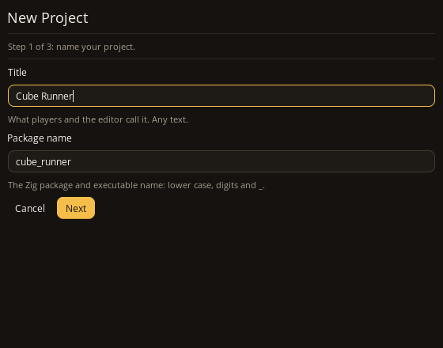
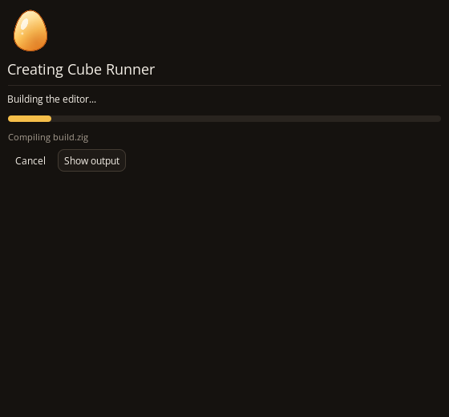
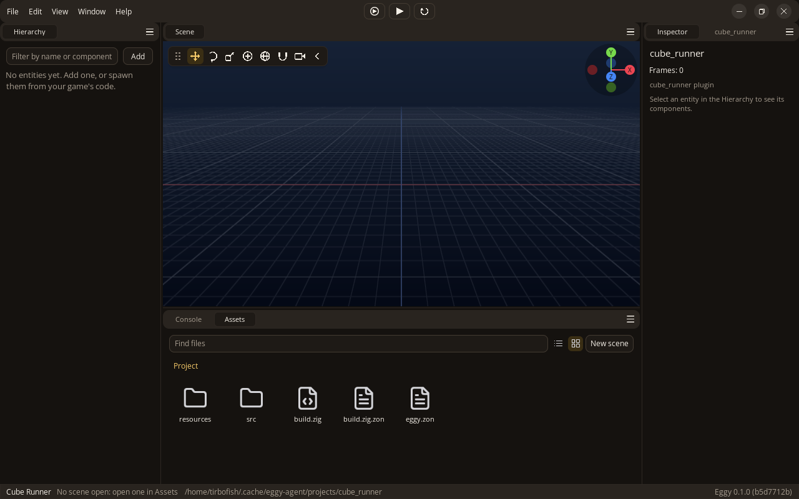
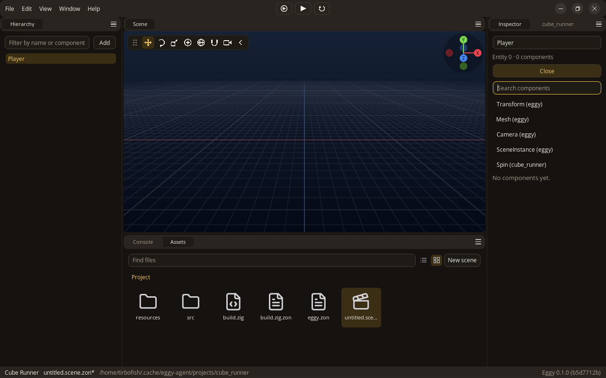
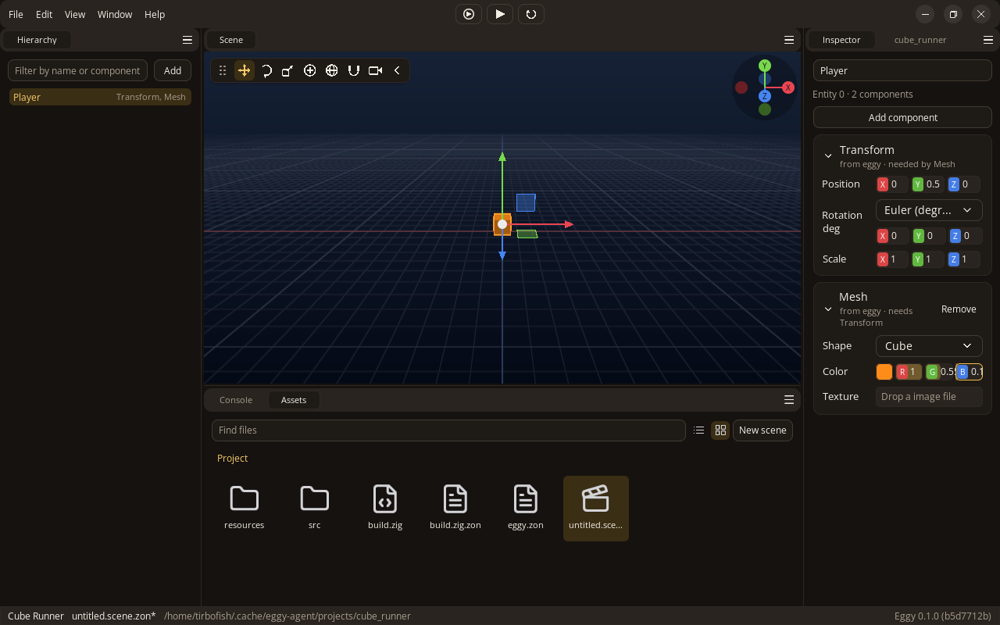
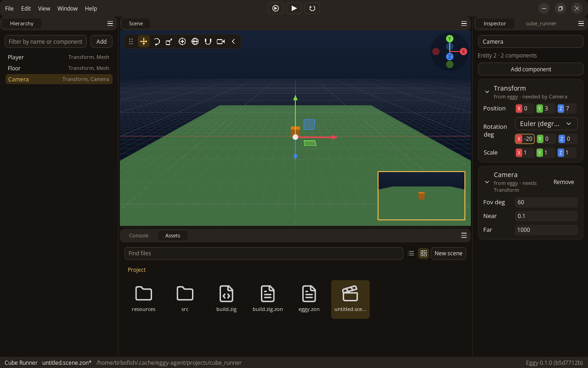
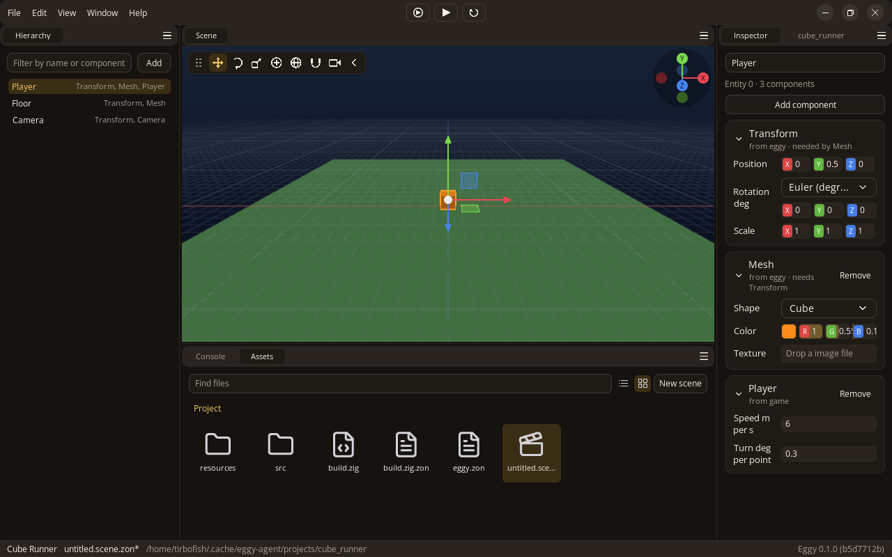
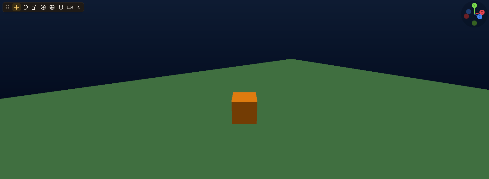

Build Cube Runner: an orange cube on a green floor that you drive with W, A, S and D
and turn with the mouse. You will create the scene in the editor, add a player
component in Zig, and make the camera follow the cube.

## Before you begin

[Install Eggy](./install.md), and have a code editor for `src/main.zig`.

## 1. Make a project {#make-a-project}

Open Eggy and press **New Project**. Use `Cube Runner` for the title and `cube_runner` for
the package name. Players see the title; Zig uses the package name. Pick an empty folder for
the project and create it.



Eggy writes the project and builds its editor. The first build takes a while; later ones are
quicker. If it fails, the [doctor](../reference/editor-cli.md#check-the-toolchain) can check
your Zig.



When it is done, the project's own editor opens:



- Hierarchy, on the left, lists the entities in the scene.
- Scene, in the middle, shows them. Hold the right mouse button and move the mouse to look around, and scroll to zoom.
- Inspector, on the right, shows the selected entity's components. Beside it is a panel from the plugin in your project's `src/root.zig`.
- Assets, at the bottom, shows the project's files. Console beside it shows what the game and its build print.

## 2. Make a scene {#make-a-scene}

A scene is a file holding entities. Choose New > Scene in Assets: the editor makes
`untitled.scene.zon` and opens it. Save it with Ctrl+S whenever you change it. The
status bar marks it with `*` while it has unsaved changes.

## 3. Add the player {#add-the-player}

An entity is a thing in the scene. On its own it is only a name. Components give it
everything else, such as where it is and what it looks like.

Press Add in the Hierarchy to make an entity, and rename it Player in the field at
the top of the Inspector. Then press Add component:



Add these two:

- Transform (under Scene) sets where the entity is, how it is turned and how big it is. Set its position's Y to `0.5`, so the cube sits on the floor.
- Mesh (under Rendering) sets what it looks like. Pick the Cube shape and an orange colour (R `1`, G `0.55`, B `0.1`).



## 4. Add the floor and the camera {#add-the-floor-and-the-camera}

Add two more entities the same way:

- Floor, with a Transform scaled to `30`, `1`, `30` and a Mesh with the Plane shape, coloured green (`0.3`, `0.5`, `0.3`).
- Camera, with a Transform at `0`, `3`, `7` turned `-20` degrees about X, so it looks down at the cube, and a Camera component.

While the camera is selected, the Scene shows what it sees in the corner:



Save the scene. Press Play at the top of the window. You should see the orange cube
and green floor through the camera. Press Play again, or Escape, to stop. The cube
does not move yet.

## 5. Make the player move {#make-the-player-move}

Your game is the `Game` type in your project's `src/main.zig`. `update` is one of the
[optional game and plugin hooks](../reference/plugin-hooks.md#hooks). Open the file
in your code editor and replace it with this:

```zig
//! cube_runner: the game. A cube you drive with WASD, turned by the mouse, with the camera
//! following behind.
const std = @import("std");
const eggy = @import("eggy");

/// Something the player drives: how fast it moves and turns.
pub const Player = struct {
    speed_m_per_s: f32 = 6,
    /// Degrees turned for each point the mouse moves, while the right button is held.
    turn_deg_per_point: f32 = 0.3,
};

pub const Game = struct {
    /// The components the editor's Inspector can add to entities.
    pub const components = .{Player};

    /// Runs once a frame while the game plays.
    pub fn update(self: *Game, app: *eggy.App) !void {
        _ = self;
        var players = app.world.query(.{ *eggy.Transform, *const Player });
        while (players.next()) |view| {
            const transform = view.get(*eggy.Transform);
            const player = view.get(*const Player);

            // Hold the right mouse button and move the mouse to turn.
            if (app.input.mouseHeld(.right)) {
                transform.rotation_deg.y -= app.input.mouse_delta.x * player.turn_deg_per_point;
            }

            // W and S go ahead and back, A and D to the sides, the way the cube faces.
            const movement = app.input.direction(.{});
            const forward = transform.forward();
            const right = transform.right();
            const step = player.speed_m_per_s * app.time.delta_s;
            transform.translate(forward.scale(movement.y).add(right.scale(movement.x)).mul(.init(step, 0, step)));

            // The camera follows: six metres behind, three up, looking down a little.
            const camera = eggy.findNamed(&app.world, "Camera") orelse continue;
            const eye = app.world.get(camera, eggy.Transform) orelse continue;
            eye.position = transform.position.sub(forward.mul(.init(6, 0, 6))).add(.init(0, 3, 0));
            eye.rotation_deg = .init(-20, transform.rotation_deg.y, 0);
            app.world.markChanged(camera, eggy.Transform);
        }
    }
};
```

`Player` is your own component. Any struct can be one; listing it in `components`
lets the editor add it and edit its fields. Each frame during Play, `update` finds
entities with both `Transform` and `Player` and moves them.

The movement comes from `app.input.direction(.{})`, which reads A/D across and S/W
ahead as `-1`, `0`, or `1` in its `x` and `y`. You can choose other keys or read one axis with `axis`.
Multiplying the speed by `app.time.delta_s` keeps it in metres per second as the
frame rate changes. The mouse movement turns the cube while the right button is
held. `eggy.findNamed` finds Camera so its transform can follow the player.

Save the file. The editor rebuilds your game and swaps it in without closing (on Linux as you
save; elsewhere when you go back to it, in the Build progress window). If the build fails, the
Console says why.

## 6. Add the player component and try the game {#make-the-cube-a-player}

Select Player in the Hierarchy, press Add component, and add Player (under Game, or type its name). Its fields
come from the struct, with their defaults. You can change them here:



Save the scene, and press Play. Hold W to drive forward and use A, S and D for the
other directions. Hold the right mouse button over the Scene while moving the
mouse to turn. The camera should stay behind the cube:



Stop Play and check that the cube returns to its saved position. Playing does not
change the scene you are editing.

## Next

Run `zig build run-runtime` in your project to play without the editor. Then
[map the player's controls](../input/map-input.md) to replace physical-key logic
with named controls.

- [Create plugins](../plugins/create-plugins.md) to share code between games.
- [Extend the editor](../plugins/extend-editor.md) with your own tools and panels.
- [Your first code-only game](./code-only-game.md) creates the world without scene files.
- [Handle errors](../game-code/handle-errors.md) in the runtime and editor.
